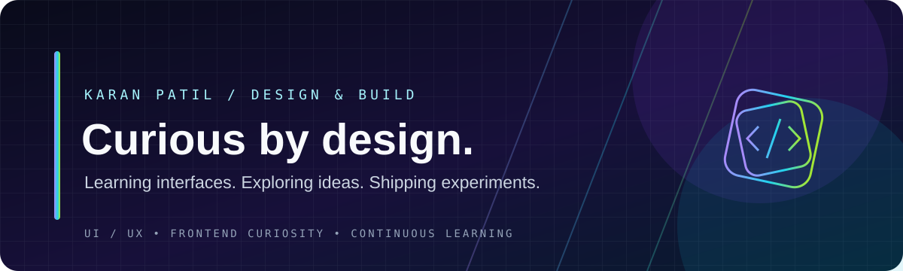

<!--
  UIUX — neon studio theme
  Uses GitHub-compatible Markdown, HTML, a local SVG banner, and shields.io badges.
-->

 

### A design playground for ideas, interfaces, and experiments.

**Observe → Explore → Prototype → Refine**

---

## ◈ The studio

This repository is a growing workspace for exploring user interfaces and user experiences. It is intended for design practice, interface breakdowns, wireframes, prototypes, and notes about the decisions behind a design.

> Learning in public. Improving one iteration at a time.

## ⌘ Current direction

| Track | What it means |
|:--|:--|
| **Interface studies** | Notice layout, hierarchy, spacing, and visual patterns |
| **UX thinking** | Ask what a user needs to do and where friction appears |
| **Prototyping** | Turn ideas into flows and screen concepts |
| **Reflection** | Record what worked, what didn't, and what to try next |

## ✳ Design principles

| CLARITY | CONSISTENCY | ACCESSIBILITY | ITERATION |
|:---:|:---:|:---:|:---:|
| Make the next step obvious | Reuse familiar patterns | Design for more people | Test, learn, refine |

## ▣ Project log

This section will grow as real work is added. Each case study should include the problem, intended audience, design decisions, iterations, and what was learned.

- [ ] First interface teardown
- [ ] First wireframe or user flow
- [ ] First clickable prototype
- [ ] Notes from usability feedback

## ⟡ Find me

- **GitHub:** [@karanpatil03](https://github.com/karanpatil03)

---

DESIGNED WITH CURIOSITY · BUILT THROUGH PRACTICE

