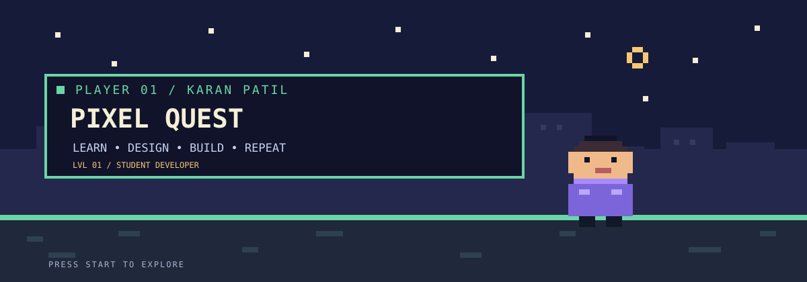

<!--
  UIUX — pixel quest theme
  Retro pixel-art styling using GitHub-compatible Markdown, HTML, and a local SVG banner.
-->

 

### A tiny pixel world for big ideas in design.

**[ EXPLORE ]** · **[ EXPERIMENT ]** · **[ LEVEL UP ]**

---

## 🕹️ Welcome, player

This repository is my design practice zone: a place to explore interfaces, learn UX fundamentals, sketch ideas, and improve through small experiments.

No finished-game claims here — just the work-in-progress journey, one level at a time.

## 🎮 Current quests

| QUEST | OBJECTIVE | STATUS |
|:--|:--|:--:|
| **01** | Study layouts, spacing, hierarchy, and visual patterns | In progress |
| **02** | Think through user goals, flows, and friction | In progress |
| **03** | Turn ideas into wireframes and screen concepts | Planned |
| **04** | Gather feedback and iterate on designs | Planned |

## 🧩 Inventory: design principles

| 🟩 CLARITY | 🟪 CONSISTENCY | 🟦 ACCESSIBILITY | 🟨 ITERATION |
|:---:|:---:|:---:|:---:|
| Make the next move clear | Keep patterns familiar | Include more people | Improve each build |

## 🗺️ The map

As real work gets added, this section will link to design explorations and case studies. Each entry should explain the challenge, intended user, choices made, and lessons learned.

- [ ] Interface teardown
- [ ] User flow or wireframe
- [ ] Clickable prototype
- [ ] Feedback and iteration notes

## 💾 Save point

- **Player:** [@karanpatil03](https://github.com/karanpatil03)
- **Repository:** [UIUX](https://github.com/karanpatil03/UIUX)

---

**PRESS START**

SMALL BUILDS · NEW SKILLS · NEXT LEVEL

